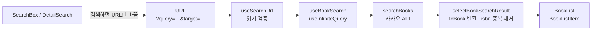

# CDRI 도서 검색 서비스

카카오(다음 검색) 책 검색 API로 책을 찾고, 마음에 드는 책을 찜해 두는 웹 서비스입니다.
CDRI 프론트엔드 사전과제로, Figma 시안 `certicos Books`를 구현했습니다.

## 1. 프로젝트 개요

### 주요 기능

| 화면          | 기능                                                                                                       |
| ------------- | ---------------------------------------------------------------------------------------------------------- |
| 도서 검색 `/` | 전체 검색(Enter), 상세 검색(제목·저자명·출판사), 검색 기록 최근 8개, 결과 10권씩 무한 스크롤, 행 펼쳐 보기 |
| 내가 찜한 책  | 검색 결과에서 하트로 찜한 책을 최근 찜한 순서로 10권씩, 새로고침해도 유지                                  |
| 그 밖         | 없는 주소·잘못된 검색 조건은 "존재하지 않는 페이지" 화면, 로딩 스켈레톤·에러 다시 시도, 모바일 너비 대응  |

### 기술 스택

React 19 · TypeScript 6.0 · TanStack Query v5 · React Router 8 · Zustand · Tailwind CSS v4 · Vite 8
테스트는 Vitest(로직)와 Playwright(브라우저), API 가짜 응답은 MSW로 만들었습니다.

### 작업 방식

- 기능을 10개 Step으로 나누고, Step마다 브랜치를 만들어 PR로 합쳤습니다.
  각 PR에는 Playwright로 녹화한 동작 영상과 판단 근거가 있습니다. ([PR 목록](https://github.com/SeoHanJoon/cdri-books-seohanjoon/pulls?q=is%3Apr+is%3Aclosed))
- 디자인에 없는 동작이나 설계 선택은 선택지와 장단점을 비교해 고르고, [ADR](docs/adr/)(설계 결정 기록)로 남겼습니다.
- Claude Code를 함께 썼습니다. 프로젝트 규칙과 작업 절차를 [`.claude/`](.claude/)에 두어, 결정은 제가 하고 AI는 선택지 정리·구현·검증을 맡는 방식으로 진행했습니다.
  계획과 Step별 체크리스트는 [docs/PLAN.md](docs/PLAN.md)에 있습니다.

## 2. 실행 방법 및 환경 설정

### 준비물

- Node.js 26.13.1 (`.nvmrc`에 고정 — `nvm use`)
- pnpm 12 (`package.json`의 `packageManager`에 고정 — `npm install -g pnpm@12`)

### 설치와 실행

```bash
pnpm install
cp .env.example .env   # 이메일로 받은 .env가 있으면 그 파일을 루트에 두면 됩니다
pnpm dev               # http://localhost:5173
```

`.env`에는 카카오 REST API 키 하나만 들어갑니다. `.env`는 `.gitignore`로 저장소에서 빠져 있고, 키 이름만 담은 `.env.example`을 커밋했습니다.

```bash
VITE_KAKAO_REST_API_KEY=발급받은_키
```

### API 키 없이 실행하기

```bash
pnpm dev:mock
```

MSW가 실제 카카오 응답을 저장해 둔 데이터를 돌려줍니다. 개발 서버에서만 켜지고 운영 빌드에는 들어가지 않습니다.

| 검색어                                   | 결과                                              |
| ---------------------------------------- | ------------------------------------------------- |
| `무라카미 하루키`                        | 3페이지(30권)까지 이어지는 결과                   |
| 상세 검색 · 저자명 · `무라카미 하루키`   | 저자명으로 찾은 결과                              |
| `느린 검색`                              | 3초 뒤 결과 (로딩 스켈레톤 확인)                  |
| `에러`                                   | 서버 에러 (다시 시도 버튼 확인)                   |
| `다음 페이지 에러`                       | 첫 페이지는 성공, 다음 페이지부터 에러            |
| 그 밖의 검색어                           | 결과 없음                                         |

### 그 밖의 명령

| 명령                                         | 하는 일                                        |
| -------------------------------------------- | ---------------------------------------------- |
| `pnpm build` / `pnpm preview`                | 운영 빌드 / 빌드 결과 미리 보기                |
| `pnpm typecheck`                             | 타입 검사                                      |
| `pnpm lint`                                  | ESLint + Prettier 검사                         |
| `pnpm test`                                  | 단위 테스트 (Vitest, 87개)                     |
| `pnpm exec playwright install chromium` 후 `pnpm e2e` | 브라우저 테스트 (Playwright, 103개). MSW를 켠 개발 서버를 스스로 띄웁니다 |
| `pnpm e2e:record`                            | 브라우저 테스트를 영상으로 녹화 (`recordings/`) |

## 3. 폴더 구조 및 주요 코드 설명

### 폴더 구조

역할별로 나눴습니다. 기능이 검색·찜 두 가지뿐이고 두 화면이 같은 컴포넌트를 함께 써서, 기능별로 나누면 공용 폴더가 대부분이 되기 때문입니다.

```
src/
├── app/          # 앱 조립: 라우터, QueryClient, 공통 레이아웃(Header + 본문)
├── pages/        # 라우트 화면: SearchPage, WishlistPage, NotFoundPage
├── components/   # 재사용 UI: BookList·BookListItem, SearchBox, DetailSearch, Select, Button …
│   └── icons/    # Figma에서 내보낸 아이콘 React 컴포넌트
├── hooks/        # 화면 로직: 검색 URL·입력, 도서 검색 쿼리, 찜, 무한 스크롤 감지
├── api/          # 카카오 API 호출과 응답 → 화면용 타입 변환
├── stores/       # Zustand store: 찜 목록, 검색 기록 (localStorage 저장)
├── lib/          # 화면과 무관한 순수 함수: URL 검증, 가격, 숫자 표시
├── types/        # 여러 폴더가 함께 쓰는 타입: Book, BookSearch
├── mocks/        # MSW handler와 실제 응답을 저장한 fixture
└── styles/       # Tailwind @theme에 옮긴 Figma 디자인 토큰
e2e/              # Playwright 브라우저 테스트 (기능별 *.spec.ts)
docs/             # 작업 계획(PLAN.md), 설계 결정 기록(adr/)
```

단위 테스트는 대상 파일 옆에 `*.test.ts`로 둡니다.

### 검색 데이터 흐름



- **URL이 검색 상태의 기준입니다.** 검색하면 URL만 바꾸고, 화면은 URL을 읽어 그립니다. 그래서 새로고침·뒤로가기·링크 공유가 그대로 동작합니다. 전체 검색과 상세 검색은 동시에 할 수 없는데, 이 규칙도 "URL에는 검색이 하나만 들어간다"로 해결됩니다. ([0042](docs/adr/0042-search-state-url.md))
- **잘못된 값은 URL을 읽는 곳에서 막습니다.** [`parseSearchParams`](src/lib/searchParams.ts)가 `target`을 `title`·`person`·`publisher`로 검증하고, 결과를 `idle`·`invalid`·`ready` 세 상태로 돌려줍니다. 검증을 통과한 값만 `SearchTarget` 타입이 되어 API 함수에 들어갈 수 있으므로, 잘못된 조건으로는 요청이 나가지 않습니다.
- **카카오 응답의 특이한 값은 변환 함수 한 곳에 가둡니다.** [`toBook`](src/api/kakaoBook.ts)이 할인가 없음(`-1`)은 `null`로, `"10자리 13자리"` 문자열인 isbn은 하나의 값으로, 문장 중간에 잘린 책 소개는 끝에 `…`를 붙여 바꿉니다. 컴포넌트는 화면용 `Book` 타입만 알고 카카오 규칙을 모릅니다.
- **페이지는 TanStack Query가 관리합니다.** [`useBookSearch`](src/hooks/useBookSearch.ts)는 `useInfiniteQuery`로 10권씩 받아 이어 붙이고, `meta.is_end`가 오면 더 요청하지 않습니다. 검색어가 없으면 `skipToken`으로 요청을 아예 만들지 않습니다. 4xx 에러(키 오류 등)는 다시 시도해도 같은 결과라 재시도하지 않습니다. ([`queryClient`](src/app/queryClient.ts))

### 도서 검색 페이지 조립

[`SearchPage`](src/pages/SearchPage.tsx)는 훅 세 개를 조합합니다. 훅마다 하는 일이 하나입니다.

| 훅                                              | 하는 일                                                           |
| ----------------------------------------------- | ----------------------------------------------------------------- |
| [`useSearchUrl`](src/hooks/useSearchUrl.ts)     | URL 읽기·검증, 검색 넣기 (지금과 같은 검색이면 방문 기록을 늘리지 않음) |
| [`useMainSearch`](src/hooks/useMainSearch.ts)   | 전체 검색 입력창 글자, 검색 실행과 검색 기록 저장                 |
| [`useDetailSearch`](src/hooks/useDetailSearch.ts) | 상세 검색 팝업의 시작 값, 상세 검색 실행                        |

상세 검색을 실행하면 페이지가 `main.clear()`로 전체 검색 입력창을 비웁니다. 두 검색의 상호 초기화가 페이지 코드에 그대로 보이도록 한 곳에 두었습니다.

### 재사용 컴포넌트

| 컴포넌트                                                          | 재사용 방식                                                                                                                |
| ----------------------------------------------------------------- | -------------------------------------------------------------------------------------------------------------------------- |
| [`BookList`](src/components/BookList.tsx) · [`BookListItem`](src/components/BookListItem.tsx) | 도서 검색과 찜 페이지가 같이 씁니다. 책 목록·찜 여부·찜 토글만 받고, 어떤 행이 펼쳐졌는지는 `BookList`가 스스로 관리합니다 |
| [`LoadMoreFooter`](src/components/LoadMoreFooter.tsx) + [`useInView`](src/hooks/useInView.ts) | 목록 끝이 보이면 `onLoadMore`를 부릅니다. 검색은 다음 API 페이지를, 찜은 [`usePagedList`](src/hooks/usePagedList.ts)로 다음 10권을 넘겨 같은 컴포넌트로 무한 스크롤합니다 |
| [`SearchBox`](src/components/SearchBox.tsx)                       | 입력 글자와 검색 기록을 props로 받는 제어 컴포넌트입니다. 상세 검색 버튼은 `detailSearch` 자리로 받아 서로 모르게 했습니다    |
| [`Select`](src/components/Select.tsx)                             | 값 타입을 제네릭으로 받아 `SearchTarget` 밖의 값을 고를 수 없습니다                                                         |
| [`Button`](src/components/Button.tsx)                             | `variant` 세 가지. `href`가 있으면 링크로 그려 구매하기(새 탭)와 앱 안 이동을 한 컴포넌트로 처리합니다                       |

### 찜과 검색 기록

- 두 store([`wishlistStore`](src/stores/wishlistStore.ts), [`searchHistoryStore`](src/stores/searchHistoryStore.ts))는 Zustand `persist`로 localStorage에 저장해 다시 열어도 남습니다.
- 찜은 누른 시점의 `Book`을 그대로 저장합니다. 찜 페이지는 API를 다시 부르지 않고 저장된 책을 보여줍니다.
- [`syncAcrossTabs`](src/stores/syncAcrossTabs.ts)가 브라우저의 `storage` 이벤트를 받아, 다른 탭에서 바꾼 찜·기록을 다시 읽습니다. 탭 두 개를 열어 두고 각자 저장해도 서로 덮어쓰지 않습니다.

### 디자인 토큰

Figma 스타일 가이드의 색과 글자 스타일을 [`src/styles/index.css`](src/styles/index.css)의 `@theme`에 옮겼습니다. Tailwind 기본 색·글자 크기는 `initial`로 지워서 `text-primary`, `text-title2`처럼 시안에 있는 이름만 쓸 수 있습니다. 시안에는 있지만 가이드에 없는 값(구분선 색, 그림자 등)은 실측해 토큰으로 추가했습니다.
