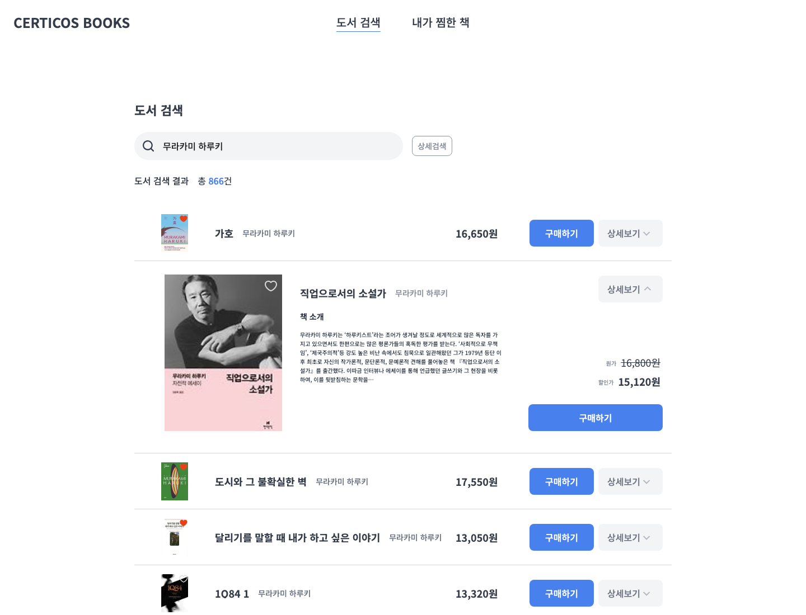
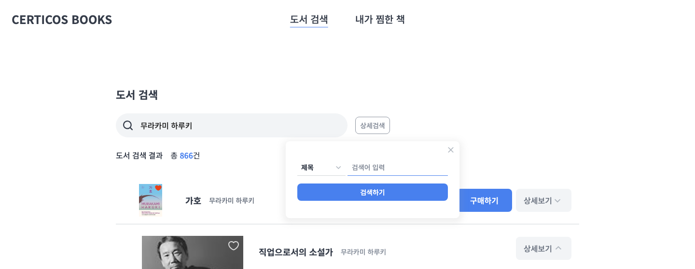
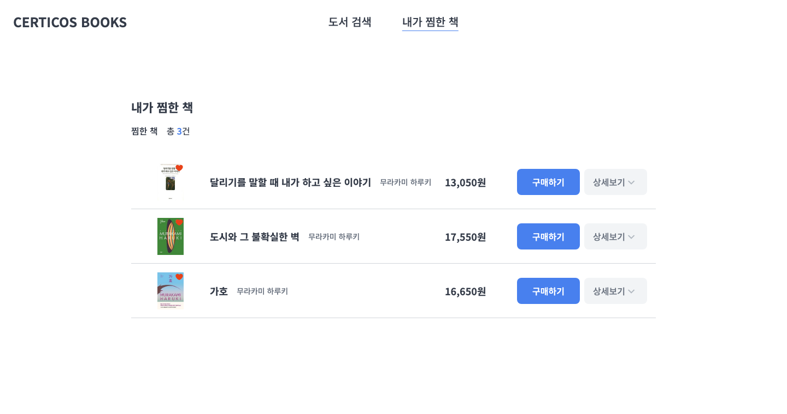
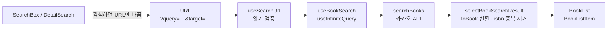

# CDRI 도서 검색 서비스

카카오(다음 검색) 책 검색 API로 책을 찾고, 마음에 드는 책을 찜해 두는 웹 서비스입니다.
CDRI 프론트엔드 사전과제로, Figma 시안 `certicos Books`를 구현했습니다.

## 1. 프로젝트 개요

### 주요 기능

| 화면          | 기능                                                                                                       |
| ------------- | ---------------------------------------------------------------------------------------------------------- |
| 도서 검색 `/` | 전체 검색(Enter), 상세 검색(제목·저자명·출판사), 검색 기록 최근 8개, 결과 10권씩 무한 스크롤, 행 펼쳐 보기 |
| 내가 찜한 책  | 검색 결과에서 하트로 찜한 책을 최근 찜한 순서로 10권씩, 새로고침해도 유지                                  |
| 그 밖         | 없는 주소·잘못된 검색 조건은 "존재하지 않는 페이지" 화면, 로딩 스켈레톤·에러 다시 시도, 모바일 너비 대응  |

### 화면

`pnpm dev:mock`의 고정 데이터로 찍었습니다. 동작은 Step PR의 영상에서 볼 수 있습니다.



| 검색 기록                                         | 상세 검색                                        |
| ------------------------------------------------- | ------------------------------------------------ |
|  |  |

| 내가 찜한 책                                 | 모바일 (390px)                                                  |
| -------------------------------------------- | --------------------------------------------------------------- |
|     |  |

### 기술 스택

React 19 · TypeScript 6.0 · TanStack Query v5 · React Router 8 · Zustand · Tailwind CSS v4 · Vite 8
테스트는 Vitest(로직)와 Playwright(브라우저), API 가짜 응답은 MSW로 만들었습니다.

### 작업 방식

- 기능을 10개 Step으로 나누고, Step마다 브랜치를 만들어 PR로 합쳤습니다.
  각 PR에는 Playwright로 녹화한 동작 영상과 판단 근거가 있습니다. ([PR 목록](https://github.com/SeoHanJoon/cdri-books-seohanjoon/pulls?q=is%3Apr+is%3Aclosed))
- 디자인에 없는 동작이나 설계 선택은 선택지와 장단점을 비교해 고르고, [ADR](docs/adr/)(설계 결정 기록)로 남겼습니다.
- Claude Code를 함께 썼습니다. 프로젝트 규칙과 작업 절차를 [`.claude/`](.claude/)에 두어, 결정은 제가 하고 AI는 선택지 정리·구현·검증을 맡는 방식으로 진행했습니다.
  계획과 Step별 체크리스트는 [docs/PLAN.md](docs/PLAN.md)에 있습니다.

## 2. 실행 방법 및 환경 설정

### 준비물

- Node.js 26.13.1 (`.nvmrc`에 고정 — `nvm use`)
- pnpm 12 (`package.json`의 `packageManager`에 고정 — `npm install -g pnpm@12`)

### 설치와 실행

```bash
pnpm install
cp .env.example .env   # 이메일로 받은 .env가 있으면 그 파일을 루트에 두면 됩니다
pnpm dev               # http://localhost:5173
```

`.env`에는 카카오 REST API 키 하나만 들어갑니다. `.env`는 `.gitignore`로 저장소에서 빠져 있고, 키 이름만 담은 `.env.example`을 커밋했습니다.

```bash
VITE_KAKAO_REST_API_KEY=발급받은_키
```

### API 키 없이 실행하기

```bash
pnpm dev:mock
```

MSW가 실제 카카오 응답을 저장해 둔 데이터를 돌려줍니다. 개발 서버에서만 켜지고 운영 빌드에는 들어가지 않습니다.

| 검색어                                   | 결과                                              |
| ---------------------------------------- | ------------------------------------------------- |
| `무라카미 하루키`                        | 3페이지(30권)까지 이어지는 결과                   |
| 상세 검색 · 저자명 · `무라카미 하루키`   | 저자명으로 찾은 결과                              |
| `느린 검색`                              | 3초 뒤 결과 (로딩 스켈레톤 확인)                  |
| `에러`                                   | 서버 에러 (다시 시도 버튼 확인)                   |
| `다음 페이지 에러`                       | 첫 페이지는 성공, 다음 페이지부터 에러            |
| 그 밖의 검색어                           | 결과 없음                                         |

### 그 밖의 명령

| 명령                                         | 하는 일                                        |
| -------------------------------------------- | ---------------------------------------------- |
| `pnpm build` / `pnpm preview`                | 운영 빌드 / 빌드 결과 미리 보기                |
| `pnpm typecheck`                             | 타입 검사                                      |
| `pnpm lint`                                  | ESLint + Prettier 검사                         |
| `pnpm test`                                  | 단위 테스트 (Vitest, 87개)                     |
| `pnpm exec playwright install chromium` 후 `pnpm e2e` | 브라우저 테스트 (Playwright, 103개). MSW를 켠 개발 서버를 스스로 띄웁니다 |
| `pnpm e2e:record`                            | 브라우저 테스트를 영상으로 녹화 (`recordings/`) |

## 3. 폴더 구조 및 주요 코드 설명

### 폴더 구조

역할별로 나눴습니다. 기능이 검색·찜 두 가지뿐이고 두 화면이 같은 컴포넌트를 함께 써서, 기능별로 나누면 공용 폴더가 대부분이 되기 때문입니다.

```
src/
├── app/          # 앱 조립: 라우터, QueryClient, 공통 레이아웃(Header + 본문)
├── pages/        # 라우트 화면: SearchPage, WishlistPage, NotFoundPage
├── components/   # 재사용 UI: BookList·BookListItem, SearchBox, DetailSearch, Select, Button …
│   └── icons/    # Figma에서 내보낸 아이콘 React 컴포넌트
├── hooks/        # 화면 로직: 검색 URL·입력, 도서 검색 쿼리, 찜, 무한 스크롤 감지
├── api/          # 카카오 API 호출과 응답 → 화면용 타입 변환
├── stores/       # Zustand store: 찜 목록, 검색 기록 (localStorage 저장)
├── lib/          # 화면과 무관한 순수 함수: URL 검증, 가격, 숫자 표시
├── types/        # 여러 폴더가 함께 쓰는 타입: Book, BookSearch
├── mocks/        # MSW handler와 실제 응답을 저장한 fixture
└── styles/       # Tailwind @theme에 옮긴 Figma 디자인 토큰
e2e/              # Playwright 브라우저 테스트 (기능별 *.spec.ts)
docs/             # 작업 계획(PLAN.md), 설계 결정 기록(adr/)
```

단위 테스트는 대상 파일 옆에 `*.test.ts`로 둡니다.

### 검색 데이터 흐름



- **URL이 검색 상태의 기준입니다.** 검색하면 URL만 바꾸고, 화면은 URL을 읽어 그립니다. 그래서 새로고침·뒤로가기·링크 공유가 그대로 동작합니다. 전체 검색과 상세 검색은 동시에 할 수 없는데, 이 규칙도 "URL에는 검색이 하나만 들어간다"로 해결됩니다. ([0042](docs/adr/0042-search-state-url.md))
- **잘못된 값은 URL을 읽는 곳에서 막습니다.** [`parseSearchParams`](src/lib/searchParams.ts)가 `target`을 `title`·`person`·`publisher`로 검증하고, 결과를 `idle`·`invalid`·`ready` 세 상태로 돌려줍니다. 검증을 통과한 값만 `SearchTarget` 타입이 되어 API 함수에 들어갈 수 있으므로, 잘못된 조건으로는 요청이 나가지 않습니다.
- **카카오 응답의 특이한 값은 변환 함수 한 곳에 가둡니다.** [`toBook`](src/api/kakaoBook.ts)이 할인가 없음(`-1`)은 `null`로, `"10자리 13자리"` 문자열인 isbn은 하나의 값으로, 문장 중간에 잘린 책 소개는 끝에 `…`를 붙여 바꿉니다. 컴포넌트는 화면용 `Book` 타입만 알고 카카오 규칙을 모릅니다.
- **페이지는 TanStack Query가 관리합니다.** [`useBookSearch`](src/hooks/useBookSearch.ts)는 `useInfiniteQuery`로 10권씩 받아 이어 붙이고, `meta.is_end`가 오면 더 요청하지 않습니다. 검색어가 없으면 `skipToken`으로 요청을 아예 만들지 않습니다. 4xx 에러(키 오류 등)는 다시 시도해도 같은 결과라 재시도하지 않습니다. ([`queryClient`](src/app/queryClient.ts))

### 도서 검색 페이지 조립

[`SearchPage`](src/pages/SearchPage.tsx)는 훅 세 개를 조합합니다. 훅마다 하는 일이 하나입니다.

| 훅                                              | 하는 일                                                           |
| ----------------------------------------------- | ----------------------------------------------------------------- |
| [`useSearchUrl`](src/hooks/useSearchUrl.ts)     | URL 읽기·검증, 검색 넣기 (지금과 같은 검색이면 방문 기록을 늘리지 않음) |
| [`useMainSearch`](src/hooks/useMainSearch.ts)   | 전체 검색 입력창 글자, 검색 실행과 검색 기록 저장                 |
| [`useDetailSearch`](src/hooks/useDetailSearch.ts) | 상세 검색 팝업의 시작 값, 상세 검색 실행                        |

상세 검색을 실행하면 페이지가 `main.clear()`로 전체 검색 입력창을 비웁니다. 두 검색의 상호 초기화가 페이지 코드에 그대로 보이도록 한 곳에 두었습니다.

### 재사용 컴포넌트

| 컴포넌트                                                          | 재사용 방식                                                                                                                |
| ----------------------------------------------------------------- | -------------------------------------------------------------------------------------------------------------------------- |
| [`BookList`](src/components/BookList.tsx) · [`BookListItem`](src/components/BookListItem.tsx) | 도서 검색과 찜 페이지가 같이 씁니다. 책 목록·찜 여부·찜 토글만 받고, 어떤 행이 펼쳐졌는지는 `BookList`가 스스로 관리합니다 |
| [`LoadMoreFooter`](src/components/LoadMoreFooter.tsx) + [`useInView`](src/hooks/useInView.ts) | 목록 끝이 보이면 `onLoadMore`를 부릅니다. 검색은 다음 API 페이지를, 찜은 [`usePagedList`](src/hooks/usePagedList.ts)로 다음 10권을 넘겨 같은 컴포넌트로 무한 스크롤합니다 |
| [`SearchBox`](src/components/SearchBox.tsx)                       | 입력 글자와 검색 기록을 props로 받는 제어 컴포넌트입니다. 상세 검색 버튼은 `detailSearch` 자리로 받아 서로 모르게 했습니다    |
| [`Select`](src/components/Select.tsx)                             | 값 타입을 제네릭으로 받아 `SearchTarget` 밖의 값을 고를 수 없습니다                                                         |
| [`Button`](src/components/Button.tsx)                             | `variant` 세 가지. `href`가 있으면 링크로 그려 구매하기(새 탭)와 앱 안 이동을 한 컴포넌트로 처리합니다                       |

### 찜과 검색 기록

- 두 store([`wishlistStore`](src/stores/wishlistStore.ts), [`searchHistoryStore`](src/stores/searchHistoryStore.ts))는 Zustand `persist`로 localStorage에 저장해 다시 열어도 남습니다.
- 찜은 누른 시점의 `Book`을 그대로 저장합니다. 찜 페이지는 API를 다시 부르지 않고 저장된 책을 보여줍니다.
- [`syncAcrossTabs`](src/stores/syncAcrossTabs.ts)가 브라우저의 `storage` 이벤트를 받아, 다른 탭에서 바꾼 찜·기록을 다시 읽습니다. 탭 두 개를 열어 두고 각자 저장해도 서로 덮어쓰지 않습니다.

### 디자인 토큰

Figma 스타일 가이드의 색과 글자 스타일을 [`src/styles/index.css`](src/styles/index.css)의 `@theme`에 옮겼습니다. Tailwind 기본 색·글자 크기는 `initial`로 지워서 `text-primary`, `text-title2`처럼 시안에 있는 이름만 쓸 수 있습니다. 시안에는 있지만 가이드에 없는 값(구분선 색, 그림자 등)은 실측해 토큰으로 추가했습니다.

## 4. 라이브러리 선택 이유

| 라이브러리                         | 쓰는 곳                      | 고른 이유                                                                                                                                                                                      |
| ---------------------------------- | ---------------------------- | ---------------------------------------------------------------------------------------------------------------------------------------------------------------------------------------------- |
| **Vite + React**                   | 빌드·개발 서버               | 모든 동작이 사용자 입력 뒤 브라우저에서 일어나서 서버 렌더링(Next.js)으로 얻는 것이 없습니다. 과제도 `.env`로 브라우저에서 API를 부르는 방식을 전제합니다. Vitest가 Vite 설정을 그대로 씁니다 |
| **TanStack Query v5** (필수)       | 도서 검색                    | `useInfiniteQuery`가 페이지 이어 붙이기·다음 페이지 판단·로딩/에러 상태를 맡습니다. 같은 검색은 캐시로 다시 요청하지 않습니다                                                                   |
| **React Router 8** (데이터 모드)   | `/`, `/wishlist`, 없는 주소  | 검색 상태를 `useSearchParams`로 URL에 둡니다. 데이터 모드는 페이지가 커지면 라우트에 `lazy`만 붙여 코드 분할할 수 있습니다                                                                       |
| **Zustand** (`persist`)            | 찜 목록, 검색 기록           | 서버에서 오는 값은 TanStack Query, 브라우저에만 있는 값은 Zustand로 나눴습니다. 찜은 "누른 시점의 책"이라 서버와 다시 맞추면 안 되는 값입니다. 공식 `persist` 미들웨어가 localStorage 저장·복원과 저장 형태 버전 관리를 해 줍니다 |
| **Tailwind CSS v4**                | 스타일 전체                  | `@theme`에 Figma 토큰을 옮기고 기본 팔레트를 지우면, 시안에 없는 색·글자 크기는 클래스 자체가 없습니다. CSS Modules보다 토큰을 지키게 만들기 쉽습니다                                           |
| **clsx**                           | 조건부 클래스 합치기         | 0.2KB. 바깥에서 받는 `className`은 너비·배치용으로만 써서 클래스 충돌을 풀어 주는 tailwind-merge(약 7KB)까지는 필요 없었습니다                                                                  |
| **@fontsource-variable/noto-sans-kr** | 폰트                      | 글자 범위별 조각 파일이라 화면에 쓰인 글자만 받습니다(전체 4.2MB → 약 200KB). 외부 서버 없이 테스트·영상에서 항상 같은 폰트가 나옵니다                                                          |
| **MSW**                            | 개발 서버·Vitest·Playwright  | 앱은 실제 `fetch`를 부르고 네트워크 단계에서만 응답을 바꿉니다. 세 곳이 handler 하나를 같이 쓰고, 지연·에러·0건을 검색어로 재현합니다. 운영 빌드에는 들어가지 않습니다                          |
| **Vitest + Playwright**            | 테스트                       | 경계값이 많은 규칙(검색 기록 9번째, 가격, URL 검증)은 빠른 단위 테스트로, 화면 흐름(키보드·한글 입력·무한 스크롤)은 실제 브라우저로 확인합니다. Playwright 녹화 영상은 PR 설명에도 씁니다          |
| **ESLint + Prettier**              | 코드 품질                    | 타입 정보를 쓰는 typescript-eslint 규칙을 켜려고 TypeScript는 이 도구가 지원하는 6.0에 맞췄습니다                                                                                               |

### 쓰지 않은 것

- **팝업·Select 라이브러리(Headless UI, Radix)**: 상세 검색 팝업 하나와 선택지 3개 Select를 위해 앱 JS가 33~39KB(약 37%) 늘어납니다. 직접 만들면 약 2KB이고, 바깥 클릭·Esc·포커스 복귀·방향키 동작은 Playwright 테스트로 지킵니다. ([0034](docs/adr/0034-detail-search-popover.md))
- **갓 배포된 버전**: pnpm의 최소 배포 기간 규칙(배포 후 24시간)을 끄지 않았습니다. 악성 버전이 발견·삭제되기 전에 설치하는 일을 피하기 위해서입니다.

## 5. 강조하고 싶은 기능

디자인은 화면 모양과 기본 동작만 정해 두었고, 나머지는 지원자 판단에 맡겼습니다. 판단이 필요한 곳마다 선택지를 비교해 정했고, 그중 대표적인 것을 적습니다.

### 검색 상태를 URL에 둬서 새로고침·뒤로가기·공유가 그대로 동작

- `/?query=무라카미 하루키`처럼 검색이 주소에 담깁니다. 새로고침해도, 링크를 공유해도 같은 결과가 나옵니다.
- 뒤로가기하면 입력창과 결과가 이전 검색으로 돌아갑니다. 이미 받은 결과는 캐시에서 바로 보여주고 다시 요청하지 않습니다.
- 주소를 직접 고쳐 `target=abc`처럼 없는 검색 조건을 넣으면, 다른 검색으로 바꿔 실행하지 않고 "존재하지 않는 페이지" 화면을 보여줍니다. API 요청도 나가지 않습니다.
- 같은 검색을 다시 해도 방문 기록이 늘지 않아, 뒤로가기를 여러 번 누를 일이 없습니다.

### 무한 스크롤 — 검색 결과와 찜 목록이 같은 방식

시안에 "페이지당 10개"만 있고 페이지 번호나 더보기 버튼이 없어서, 목록이 이어지는 무한 스크롤로 정했습니다. ([0003](docs/adr/0003-infinite-scroll.md))

- 목록 끝이 화면 200px 안으로 들어오면 다음 10권을 불러옵니다. 첫 결과가 화면보다 짧으면 스크롤하지 않아도 화면이 찰 때까지 이어서 부릅니다.
- 마지막 페이지(`is_end`)를 받으면 더 요청하지 않고, 펼쳐 둔 행은 다음 페이지를 붙여도 그대로 펼쳐져 있습니다.
- 찜 페이지는 저장된 책을 10권씩 잘라 **같은 컴포넌트**(`LoadMoreFooter`)로 보여줍니다. 두 화면의 스크롤 경험이 같습니다.

### 로딩·에러 화면 — 불러오는 동안 화면이 밀리지 않고, 다음 페이지가 실패해도 보던 목록은 남음

- 불러오는 동안 책 행과 높이가 같은 스켈레톤을 보여줘서, 결과가 와도 화면이 밀리지 않습니다.
- 새 검색을 불러오는 동안 "총 N건"은 직전 숫자를 그대로 둡니다. 0으로 떨어졌다 다시 올라가는 깜빡임이 없습니다.
- 첫 페이지가 실패하면 안내와 "다시 시도" 버튼을, 다음 페이지가 실패하면 받은 목록은 그대로 두고 아래에만 "다시 시도"를 보여줍니다.
- API 키 오류 같은 4xx는 다시 해도 같은 결과라 자동 재시도하지 않습니다. 서버 오류(5xx)나 네트워크 오류만 한 번 재시도합니다.

### 찜 페이지에서 실수로 해제해도 되돌릴 수 있음

찜 페이지에서 하트를 끄면 그 행이 바로 사라지는 대신, 빈 하트로 자리에 남습니다. ([0053](docs/adr/0053-wishlist-store-and-page.md))

- 다시 누르면 처음 찜했을 때의 정보 그대로 다시 찜합니다. "총 N건"은 실제 찜 수라 바로 줄어듭니다.
- 행이 사라지지 않으니 키보드 포커스도 제자리에 있습니다. 도서 검색에 다녀오면 해제한 책은 정리됩니다.
- 찜과 검색 기록은 다른 브라우저 탭과도 맞춰집니다. 두 탭에서 각각 찜해도 서로 덮어쓰지 않습니다.

### 성능 — 측정하고 결정

| 한 일                                  | 결과                                                                                                     |
| -------------------------------------- | -------------------------------------------------------------------------------------------------------- |
| `BookListItem` `memo` + 콜백이 책·isbn을 받게 변경 | 20권이 있을 때 다시 그리는 행: 검색창 한 글자 입력 40 → **0**, 하트 하나 토글 40 → **2** ([0056](docs/adr/0056-book-list-item-memo.md)) |
| 검색 결과 `staleTime` 5분              | 찜 페이지에 다녀오거나 브라우저 탭으로 돌아올 때 불러온 페이지 수만큼 하던 재요청 → **0번**                         |
| 표지 이미지 `loading="lazy"`           | 화면 밖 표지는 스크롤해서 가까워질 때 받습니다                                                           |
| 라우트 코드 분할                       | 나눠 보니 첫 화면 JS가 오히려 0.6KB 커져서 **하지 않았습니다** ([0061](docs/adr/0061-no-route-code-splitting.md)) |
| 팝업·Select 직접 구현                  | 라이브러리를 쓰면 +33~39KB, 직접 만들어 약 2KB                                                           |

운영 빌드 JS는 gzip 약 120KB이고, MSW 코드와 worker 파일은 들어가지 않습니다.

### 키보드·화면 낭독기·한글 입력

- 한글을 조합하는 중에 Enter를 눌러도 검색이 **한 번만** 실행됩니다. 키 입력으로 Enter를 잡지 않고 `<form>` 제출로 받았기 때문입니다. (키 입력으로 잡으면 조합 중 Enter에서 두 번 실행됩니다)
- 상세 검색 팝업은 바깥 클릭·Esc·X로 닫히고, 닫히면 포커스가 '상세검색' 버튼으로 돌아옵니다. 검색 조건 Select는 방향키로 고릅니다.
- 행마다 같은 이름인 '상세보기'·'찜하기'·'구매하기' 버튼에 책 제목을 설명으로 연결해, 화면 낭독기가 어느 책의 버튼인지 읽습니다. 검색 건수가 바뀌면 화면 낭독기가 새 건수를 읽습니다.
- 이 동작들은 Playwright 테스트 103개가 실제 키보드·한글 입력으로 지킵니다.

### 아이콘 — 시안을 일부 바꿔 컴포넌트를 통일

시안에서는 같은 모양의 아이콘이 놓이는 곳마다 크기·비율·색이 제각각이었습니다. 하트는 4가지, 화살표는 2가지 크기, 닫기 X는 2가지 크기와 색이었습니다. 그대로 옮기면 같은 아이콘이 여러 벌 생깁니다. 디자인 쪽 규격이 통일되지 않은 것으로 보고, 시안을 일부 바꾸더라도 디자인 컴포넌트의 통일성을 지키는 것이 옳다고 판단했습니다. ([0024](docs/adr/0024-icon-component-props.md))

- 하트·화살표·닫기 X를 모양마다 컴포넌트 하나(`HeartIcon`, `ChevronIcon`, `CloseIcon`)로 만들고, 정해진 크기만 받게 했습니다. 쓰는 쪽은 `<HeartIcon filled={liked} size={16} />` 한 줄이면 되고, 색은 컴포넌트가 정합니다. 닫기 X만 놓이는 곳(팝업은 회색, 검색 기록은 검정)마다 색이 달라 색을 받습니다.
- 원본 SVG 하나를 크기만 바꿔 쓰기 때문에, 아래 부분은 시안과 다릅니다.

| 위치                         | 시안        | 구현                                 |
| ---------------------------- | ----------- | ------------------------------------ |
| 접힌 행의 빈 하트            | 흰색 테두리 | 회색 테두리 (펼친 행의 빈 하트와 같은 색) |
| 상세보기 버튼 화살표         | 14×8        | 약 12.6×7.2                          |
| 상세보기 버튼 안 글자·화살표 | -           | 화살표가 작아진 만큼 시안보다 4px 왼쪽 |
| 검색 기록 X                  | 16px        | 14px                                 |

### 그 밖의 판단

| 디자인에 없던 것                 | 정한 동작                                                                                           |
| -------------------------------- | --------------------------------------------------------------------------------------------------- |
| 접힌 행의 작은 하트              | 표시만 하지 않고 바로 찜할 수 있게 했습니다. 누르는 영역은 넓히고, 눌러도 행은 펼쳐지지 않습니다     |
| isbn이 같은 책이 두 번 올 때     | 처음 것만 보여줍니다. 실제 응답 866건 중 7건이 겹쳤고, isbn이 목록 key이자 찜 기준이기 때문입니다    |
| 중간에 잘린 책 소개              | 카카오가 250자 안팎에서 문장 중간에 자릅니다. 끝에 "…"를 붙여 잘린 것을 알립니다                   |
| 검색 기록에 남기는 검색          | 사용자가 실행한 검색만 남깁니다. 뒤로가기·새로고침·받은 링크는 남기지 않고, 같은 검색어는 맨 앞으로 옮깁니다 |
| 상세 검색과 검색 기록            | 기록 드롭다운이 전체 검색창에 붙어 있어 전체 검색만 남깁니다                                         |
| 상세 검색어가 비었을 때          | 팝업을 닫지 않고 입력창으로 포커스를 옮깁니다. 화면 낭독기는 "검색어를 입력해 주세요"를 읽습니다                   |
| 화면 너비                        | 시안은 1920px 하나지만 모바일까지 대응했습니다. 좁아지면 헤더는 로고와 탭을 두 줄로, 책 행은 세로로 쌓습니다 |
| 없는 주소                        | 헤더는 그대로 두고 "존재하지 않는 페이지입니다."와 도서 검색으로 돌아가는 버튼을 보여줍니다           |
| 찜 목록 순서                     | 최근 찜한 책이 맨 위. 방금 찜한 책을 바로 확인할 수 있습니다                                         |
